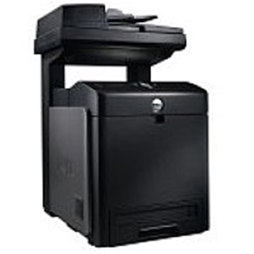
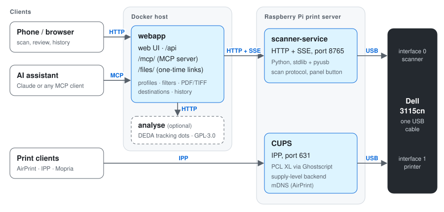
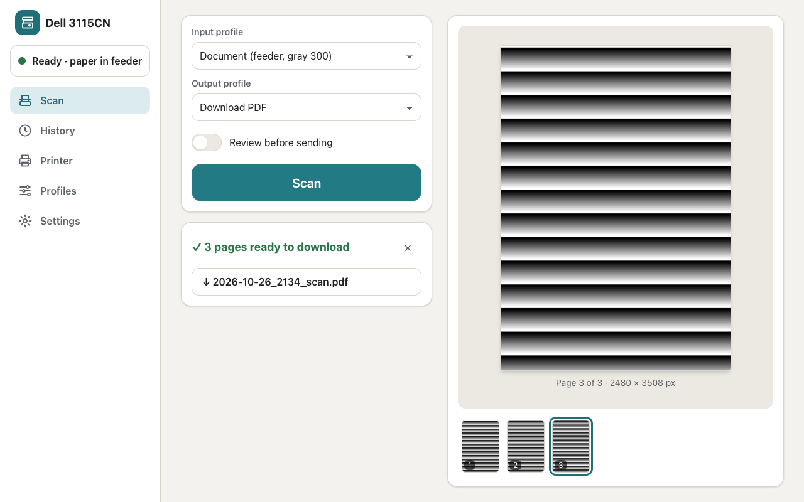
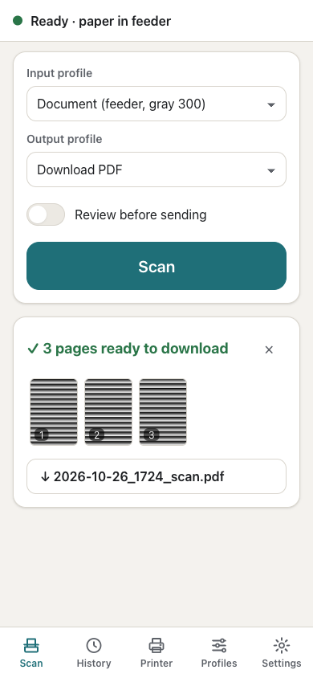
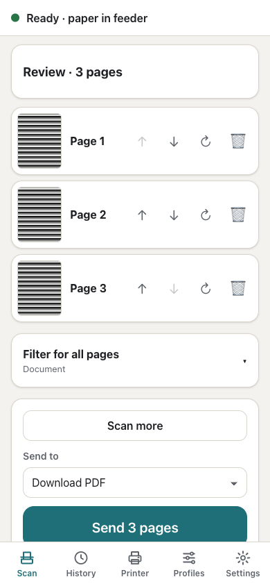
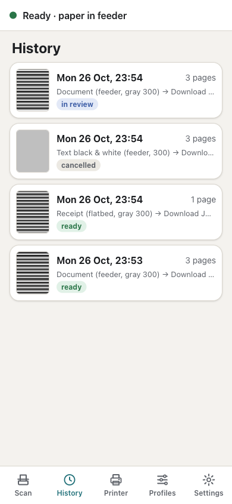
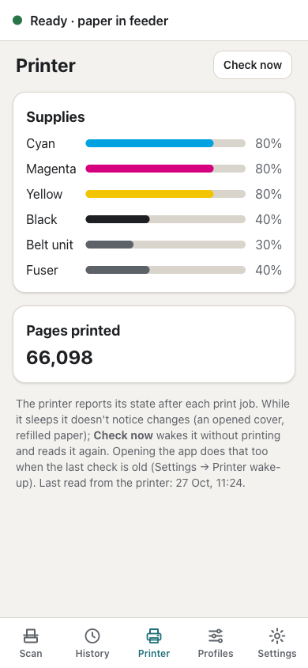
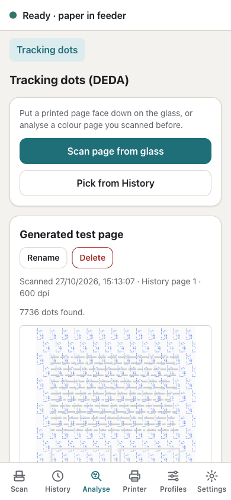

# dell3115cn-centre

Scanning and printing for the **Dell MFP Laser 3115cn** (USB `413c:5607`) on Linux.

<p align="center">
  <br>
  <sub>Dell MFP Laser 3115cn. Photo © Dell Inc.</sub>
</p>

## Why

I have a very old behemoth of a colour laser printer: the Dell MFP Laser 3115cn, from around 2007. There was no
scanning software I could use for it, and the printing setup wasn't working well either. Dell only ever shipped
Windows scanner drivers, and no SANE backend supports it.

So I put a Raspberry Pi next to it, on its USB port, and made it a network printer and scanner that works from phones,
laptops and AI assistants. Getting there meant recovering the USB scan protocol from Dell's Windows driver (for
interoperability), writing a scanner service, a phone-friendly web app with an MCP server, and a faster, better CUPS
print driver.

## What's here

| Part | What it does |
|---|---|
| [`scanner-service/`](scanner-service/) | Python service on the print server (e.g. a Raspberry Pi). Owns the scanner over USB and offers scanning over HTTP + server-sent events: flatbed and feeder, line art / gray / colour, 75–600 dpi, 8- or 16-bit colour, regions, the panel's Scan button. Stdlib + pyusb, runs on 32-bit ARM. |
| [`webapp/`](webapp/) | Bun + TypeScript + React app in Docker. Input and output profiles, preview with region selection, automatic page orientation, filters (incl. sharpening that undoes the scanner's measured blur), review tray, single/multi-page PDF, PNG, JPEG, TIFF, delivery to download, folder, SFTP, FTP, Paperless-ngx, Papra or a webhook, history. |
| [`analyse/`](analyse/) | Optional service for the web app's *Analyse* section: finds the yellow tracking dots a colour laser printer puts on every page in a scan and decodes them with [DEDA](https://github.com/dfd-tud/deda). Separate image, GPL-3.0-or-later (see [License](#license)). Details: [`docs/ANALYSE.md`](docs/ANALYSE.md). |
| `webapp` → `/mcp/` | MCP server: an AI assistant (e.g. Claude) can check the scanner, scan with its own settings, look at and zoom into pages, get one-time download links, and manage profiles and history. |
| [`cups/`](cups/) | Print driver: PCL XL rendered on the server by Ghostscript (minutes faster than the printer's own PostScript for photo pages, true grayscale), JPEG-preserving image filter, toner, belt unit and fuser levels in CUPS. |
| [`tools/scan3115.py`](tools/scan3115.py) | Single-file command-line scanner (pyusb), the original prototype. |



Scanning and printing share the USB connection: the scanner is interface 0, CUPS uses interface 1.



<p align="center">
  
  
  
  
  
</p>

## Getting started

1. **Printer (optional):** install the CUPS driver on the print server, see [`cups/README.md`](cups/README.md).
2. **Scanner service** on the same machine:
   ```sh
   rsync -a scanner-service/ <user>@<print-server>:scan3115/
   ssh <user>@<print-server> 'cd scan3115 && sudo ./deploy/install.sh'
   curl http://<print-server>:8765/api/status
   ```
   Details: [`scanner-service/README.md`](scanner-service/README.md).
3. **Web app** on any Docker host (linux/amd64 or linux/arm64), from the published image. Create a folder with this
   `compose.yml`:
   ```yaml
   services:
     dell3115cn-centre:
       image: ghcr.io/j3lte/dell3115cn-centre:latest    # or a fixed version, e.g. :1.0.0
       ports:
         - "8080:8080"
       environment:
         SERVICE_URL: http://<print-server>:8765         # the scanner service from step 2
         APP_SECRET: <output of: openssl rand -base64 32> # keep it: it encrypts stored passwords and tokens
         TZ: Etc/UTC                                     # your time zone, used in file names
       volumes:
         - ./data:/data
         # Dell's colour profile (see below); add this line once the file is in the folder:
         # - ./dell3115cn.icm:/app/assets/dell3115cn.icm:ro
         # Folder destinations write inside the container; mount the target, e.g.:
         # - /srv/archive:/archive
       restart: unless-stopped
   ```
   Then:
   ```sh
   mkdir -p data && sudo chown 1000:1000 data   # the container runs as uid 1000
   docker compose up -d
   ```
   Open `http://<docker-host>:8080`. All settings: [`webapp/README.md`](webapp/README.md).
4. **Tracking dots (optional):** to get the *Analyse* section, which finds and decodes the yellow tracking dots on
   colour prints, add the analyse service to the same `compose.yml` and set `ANALYSE_ENDPOINT` on the web app:
   ```yaml
   services:
     dell3115cn-centre:
       # … as in step 3, with one more environment variable:
       environment:
         ANALYSE_ENDPOINT: http://analyse:8770
     analyse:
       image: ghcr.io/j3lte/dell3115cn-centre-analyse:latest   # same tags as the web app image
       mem_limit: 1536m                                        # a 600 dpi page needs up to about 1 GiB
       restart: unless-stopped
   ```
   Without `ANALYSE_ENDPOINT` the section is hidden. How it works, what the results mean and the service's API:
   [`docs/ANALYSE.md`](docs/ANALYSE.md).
5. **AI assistants:** Settings → *AI assistants (MCP)* shows the endpoint, the key and a ready-made
   `claude mcp add …` command.

### Dell's colour profile

Colour scans need the scanner's ICC profile, which is Dell's and not included. Extract it from Dell's driver download:
[`webapp/assets/README.md`](webapp/assets/README.md). Without it everything works, but colours have a magenta cast.

## Documentation

| Document | What |
|---|---|
| [`docs/PROTOCOL.md`](docs/PROTOCOL.md) | The USB scan protocol: transactions, commands, Set Window, image data, feeder, buttons, limits |
| [`docs/PRINTER.md`](docs/PRINTER.md) | The device: USB interfaces, firmware, CUPS analysis, printing speed, PCL XL driver, status record (supplies, alerts, page count), network port (SNMP, web page) |
| [`docs/SCAN-QUALITY.md`](docs/SCAN-QUALITY.md) | 600 dpi limit, 16-bit, measured sharpness (MTF), deconvolution, tracking dots |
| [`docs/REVERSE-ENGINEERING.md`](docs/REVERSE-ENGINEERING.md) | How the drivers were decompiled and the findings verified, so you can repeat it |
| [`docs/ANALYSE.md`](docs/ANALYSE.md) | The *Analyse* section: finding and decoding printer tracking dots (DEDA), the analyse service, its API, privacy |
| [`webapp/docs/PROFILES.md`](webapp/docs/PROFILES.md) | Web app input and output profiles: settings, filters, formats, file names, destinations, the common profiles |

## Status

Developed against a Raspberry Pi Zero 2 W print server (Debian 12). Verified on hardware: flatbed and feeder in all modes, 16-bit
colour, the panel's Scan button, printing (PCL XL, two-sided, grayscale), supply levels, the MCP server end to end.
Open items: [`TODO.md`](TODO.md).

## How it was built

This project was developed entirely with **Claude Opus 5.5** (in Claude Code). Claude decompiled Dell's drivers,
worked out the protocol, wrote the code and documentation, and did most of the testing autonomously: the test
suites, the simulator, and hardware tests run on the print server itself. I gave the direction and made the
decisions, and did what needs hands: loading paper, pressing the printer's Scan button, starting test scans and
checking the printed pages.

## Development

```sh
cd scanner-service && uv run --python 3.11 --with pytest pytest -q     # service tests (simulator, no hardware)
cd webapp && bun install && bun test                                 # web app tests
docker build --target test webapp                                    # web app tests on Alpine (ImageMagick, Tesseract)
uv run --with pytest pytest cups/tests                               # print filter tests
uv run --with pytest pytest tools/tests                               # release script tests (changelog, version)
cd analyse && uv run --with pytest pytest -q                          # analyse service tests (generated pages)
docker build --target test analyse                                   # analyse service tests in its image
```

Both the service (`SCAN3115_SIM=1`) and the web app run against a simulated scanner, so most work needs no hardware.

GitHub Actions ([`.github/workflows/ci.yml`](.github/workflows/ci.yml)) runs all of the above on every push and pull
request, including test builds of both images. **Releases:** run the *Release* workflow (Actions → Release → Run
workflow) and choose *patch*, *minor* or *major* (1.0.3 becomes 1.0.4, 1.1.0 or 2.0.0), or type an exact version; it
tags the head of `main`. Pushing a tag `x.y.z` (semver, no `v`) on `main` yourself works too. CI then publishes the
web app image and the analyse image to GitHub Container Registry as `x.y.z` and `latest`. Every other push to `main` is
published as `build-<short commit hash>` (e.g. `build-a1b2c3d`) for testing; it never moves `latest`. Changes are
listed under `## [Unreleased]` in [`CHANGELOG.md`](CHANGELOG.md). After a release is published, CI renames that section
to the version, with a link comparing it with the previous release, opens a new `[Unreleased]` section and creates the
GitHub release with the same items ([`tools/changelog.py`](tools/changelog.py)).

## License

Licensed under the [Apache License 2.0](LICENSE), except [`analyse/`](analyse/) and the
`ghcr.io/j3lte/dell3115cn-centre-analyse` image, which are licensed GPL-3.0-or-later because they use
[DEDA](https://github.com/dfd-tud/deda) (GPLv3 or later); see [`analyse/LICENSE`](analyse/LICENSE). The web app only
talks to that service over HTTP and stays Apache-2.0.

Not affiliated with or endorsed by Dell. "Dell" is a trademark of Dell Inc. No Dell software, drivers, PPDs or colour
profiles are included; the protocol was recovered for interoperability and is documented in this repository's own
words. The printer photo (`docs/dell-3115cn.jpg`) is Dell's product image, © Dell Inc.
