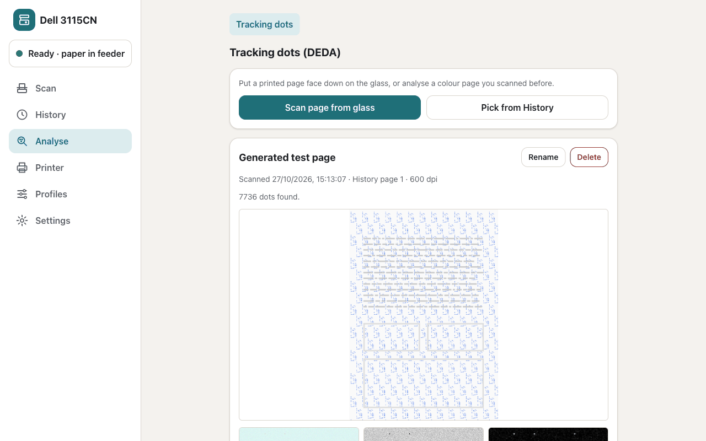

# Analyse: tracking dots (DEDA)

Colour laser printers, the 3115cn among them, print a faint pattern of yellow dots on every colour page: the
"machine identification code". The dots are about 0.1 mm across, sit on a 1 mm grid and repeat in blocks over the
whole page. The web app's **Analyse** section finds these dots in a scan and decodes them with
[DEDA](https://github.com/dfd-tud/deda) (tracking Dots Extraction, Decoding and Anonymisation, from TU Dresden), so
you can see what your printer puts on paper.

The analysis runs in a separate service, [`analyse/`](../analyse/) (image `ghcr.io/j3lte/dell3115cn-centre-analyse`),
because DEDA is GPLv3; the web app talks to it over HTTP. The section appears only when the web app's
`ANALYSE_ENDPOINT` is set.



## Using it

Open **Analyse → Tracking dots** and either:

- **Scan page from glass**: put a printed colour page face down on the flatbed. The app scans it as A4, colour,
  600 dpi, 8-bit, without filters or automatic orientation. This scan is temporary: it never shows in History and is
  deleted as soon as the analysis finishes or fails.
- **Pick from History**: choose a colour page you scanned before (the newest 50 scans with colour pages of at least
  300 dpi are offered). Pages below 600 dpi show the warning "Below 600 dpi the dots are hard to see; results may miss
  them." Gray and line-art pages, and pages under 300 dpi, can't be analysed.

Each analysis becomes an entry, named `Deda scan YYYY-MM-DD hh:mm:ss` after the time of the scan (in the app's `TZ`).
An entry shows:

- an overview of the page, washed out to gray, with every dot found drawn in blue;
- three close-ups of the same 12 mm square, the one with the most dots and no ink: as scanned, enhanced (the blue
  channel stretched, where yellow dots show dark) and the yellowness map;
- the fields DEDA decoded (pattern, serial, date and time, manufacturer, raw bits), or DEDA's message when it found a
  grid it could not decode.

Entries can be renamed and deleted, and **Clear history** deletes all of them. Deleting an entry never touches the scan
in History. Analyses run one at a time; a second one waits for the first.

### "No tracking dots found"

This means no regular 1 mm dot grid stood out on the page. It does not prove the page has no dots. Common reasons:

- the page was printed in grayscale (black toner only): this printer then prints no visible pattern;
- the page is mostly covered with ink or colour, so little blank paper is left to find dots on;
- the scan is too coarse (below 600 dpi) or was filtered (sharpening, "document", black-and-white);
- the page did not come from a colour laser printer.

For the best chance, scan a mostly white colour print at 600 dpi.

### Resolution

600 dpi works best: a dot is then 2 to 3 pixels wide. At 300 dpi a dot is about one pixel and often lost in noise;
the app still allows it, with the warning above. Below 300 dpi pages are refused. 16-bit colour pages are accepted
and analysed like 8-bit ones.

## How detection works

DEDA decodes a clean dot pattern but does not find the faint dots in a raw scan, so the service finds them first
(`analyse/deda_svc/detect.py`):

1. **Paper white**: the median colour of the bright pixels is taken as the paper and every pixel is divided by it,
   which removes the scanner's colour cast and tinted paper.
2. **Yellowness**: per pixel, min(R, G) − B. Ink pixels (any channel below about half) count as zero.
3. **Coloured-ink mask**: strongly coloured pixels that are not yellowish by hue (red, magenta, blue, green ink),
   plus a small margin around them, are masked out, so the yellow fringes of printed colour are not taken for dots.
4. **Dots**: small spots well above the page's yellowness level, of the size of a tracking dot.
5. **1 mm grid check**: the page is cut into tiles of about 20 × 20 mm; in each tile with dots the yellowness is folded
   modulo the 1 mm period. A real dot grid gives a sharp peak. The page counts as *found* when the 75th percentile of
   the tile scores is above 3 and there are at least 50 dots (the percentile, not the median, because ink hides the
   grid in many tiles of a real page).
6. **Decode**: the found dot centres are redrawn as clean yellow dots on white at 300 dpi and that image is given to
   DEDA's parser.

All sizes scale with the dpi of the scan.

## Running the service

Add it next to the web app in the same `compose.yml` and point the web app at it:

```yaml
services:
  dell3115cn-centre:
    # … as in the README's "Getting started" …
    environment:
      ANALYSE_ENDPOINT: http://analyse:8770
  analyse:
    image: ghcr.io/j3lte/dell3115cn-centre-analyse:latest   # same tags as the web app image
    mem_limit: 1536m
    restart: unless-stopped
```

The service needs no ports published when only the web app uses it. It runs as a non-root user, keeps nothing on disk
and never logs request content. A 600 dpi A4 page needs up to about 1 GiB of memory while it is analysed, so give
the container 1.5 GiB; one page is analysed at a time. An analysis usually takes seconds; the web app gives up after
180 s ("timed out after 180 s"), and when the service can't be reached the entry
fails with "Analyse service unreachable". Either way the section stays usable.

For development, build it from source: `cd analyse && docker compose up --build` (the build runs the test suite
first), or `cd analyse && uv run python -m deda_svc`.

## HTTP API

The service listens on port 8770 (`PORT` to change).

- `GET /health` answers `200 {"ok": true, "service": "analyse", "analyses": ["deda"]}`.
- `POST /deda/?dpi=600` with the page image as the body: PNG (8 or 16 bit), PNM, TIFF or JPEG, colour. `dpi` is the
  scan's resolution, 150 to 1200 (default 600). The web app always sends the stored lossless PNG with
  `Content-Type: image/png`.
  - `200` with the report: `found`, `dots`, `gridScore`, `dpi`, `paperWhite` (`[r, g, b]`, 0–255), `decode` (the
    decoded fields, or `null`), `decodeError` (DEDA's message when a found grid could not be decoded, else `null`),
    `closeOrigin` (`[y, x]` of the close-ups in pixels, or `null`) and `images` (base64 PNG: `overview`, and when
    there are dots `closeRaw`, `closeEnhanced`, `closeYellow`);
  - `400 {"error": "invalid", "message": …}`: bad `dpi`, missing or empty body, unreadable image, corrupt gzip body;
  - `413 {"error": "too_large"}`: body over 256 MiB;
  - `415 {"error": "unsupported_encoding"}`: a `Content-Encoding` other than `gzip` or `identity`.

**Compression, both ways.** A client that sends `Accept-Encoding: gzip` (the web app does) gets JSON responses of
1 KiB or more gzip-compressed (`Content-Encoding: gzip`, `Vary: Accept-Encoding`). A request body may be
gzip-compressed too (`Content-Encoding: gzip`); the 256 MiB limit then applies to the decompressed size.

**Limits.** One analysis at a time (further requests wait); a client that stalls for 60 s while sending is dropped.

The web app's own endpoints for the section are under `/api/analyse/deda` (list, scan from glass, analyse a History
page, rename, delete, clear, images) and are described in its OpenAPI reference at `/api/docs`. They answer
`404` when `ANALYSE_ENDPOINT` is not set.

## Privacy

A decode can identify your printer. The service stores nothing. The web app keeps the analyses (the decoded fields)
in its SQLite database and their images in `DATA_DIR/deda/`, inside its own data folder. Pages go only to the analyse
service you configured, which keeps nothing.
Delete entries or use **Clear history** to remove them. Scans made from the glass for an analysis are deleted when the
analysis ends.

## License

`analyse/` and the `ghcr.io/j3lte/dell3115cn-centre-analyse` image are licensed GPL-3.0-or-later
([`analyse/LICENSE`](../analyse/LICENSE)) because they use DEDA (GPLv3 or later). The rest of the repository,
including the web app, is Apache-2.0 and only talks to the service over HTTP.
